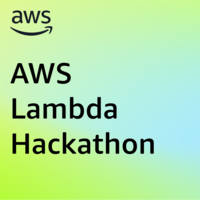

<p align="center">
  
</p>

<p align="center">
  <a href="https://github.com/Alejo2075/aws-cloud-engineer/actions/workflows/ci.yml"></a>
  <a href="https://github.com/Alejo2075/aws-cloud-engineer/releases"></a>
  <a href="LICENSE"></a>
  
  
</p>

Cloud Engineer is a serverless AI system that turns a natural-language prompt into a tested AWS application: an API Gateway + Lambda + DynamoDB + Cognito project defined with AWS CDK. It plans a validated blueprint, generates the code, runs the quality gates, and stops at an approval that is bound to the exact deployment plan before anything is deployed. The result comes with its source, test evidence and a machine-readable hand-off manifest.

<p align="center">
  <a href="https://awslambdahackathon.devpost.com/"></a>
  This project is part of the <a href="https://awslambdahackathon.devpost.com/"><b>AWS Lambda Hackathon</b></a>
</p>

## Features

- **Plan**: a prompt becomes a schema-validated Application Blueprint through Amazon Bedrock, or you supply your own. Every functional requirement must be covered by a task, and the planner may ask up to three blocking questions instead of guessing.
- **Generate**: deterministic templates produce a real TypeScript CDK project: HTTP API, Lambda (Node 22, arm64), on-demand DynamoDB with point-in-time recovery, Cognito JWT on every route, per-user data isolation and a throttled stage. Generated apps are API only.
- **Verify**: install, typecheck, unit tests and `cdk synth` run through allow-listed commands, a security review of the synthesized template (public routes, IAM wildcards, fixed-cost resources) blocks risky plans, and a bounded repair loop can fix failing gates.
- **Approve and deploy**: approval is bound to the plan hash, environment, run and AWS account. Deployment uses a pinned CDK CLI on the exact assembly that was planned, and `deployed` and `verified` are reported separately.
- **Hand off**: a `CloudSystemManifest`, domain events, a local git commit or push of the source, and an optional control plane (Step Functions, a worker and an IAM-authenticated API) defined in CDK.

## How it works

1. **Describe**: you give a prompt, a target account, region and environment. Nothing contacts AWS yet.
2. **Plan**: the planner returns a Blueprint, or asks for the one thing it cannot assume. It is validated and traced from requirements to tasks.
3. **Generate**: the Blueprint is rendered into a TypeScript CDK project in the run directory.
4. **Verify**: gates and the template review run; a failure stops the run with evidence, and `resume` retries from the failed stage.
5. **Review**: a deployment plan lists resources, risks, cost notes and gets an immutable SHA-256. The run waits in `AWAITING_APPROVAL`.
6. **Approve and deploy**: a person approves that exact hash for one environment. A changed assembly, a wrong account or a replayed deployment is refused.
7. **Verify and hand off**: unauthenticated calls to the API must be rejected, then the manifest is written and the source can be exported.

## Quick start

Requires Node.js 22+ and pnpm 9. Planning with a model needs Amazon Bedrock access to a model in your account; deploying needs AWS credentials and a CDK-bootstrapped account.

```bash
git clone https://github.com/Alejo2075/aws-cloud-engineer.git
cd aws-cloud-engineer && pnpm install && pnpm test
```

Try it without any AWS call by supplying your own blueprint; nothing contacts AWS until you approve:

```bash
pnpm build
node apps/cli/dist/index.js create "restaurant booking API" \
  --account 123456789012 --blueprint examples/reservation-app/blueprint.json
```

With a model instead of `--blueprint`, then approve the printed plan and export the result:

```bash
export CLOUD_ENGINEER_MODEL_ID=<your Bedrock model or inference profile id>
node apps/cli/dist/index.js create "Build a booking API" --account 123456789012 --region us-east-1
node apps/cli/dist/index.js approve <run-id> --plan-hash <hash> --environment staging
node apps/cli/dist/index.js export <run-id> --output ./booking-api --git
```

Other commands: `status`, `runs list`, `runs artifacts`, `respond`, `resume` and `cancel`; run with `--help` for details.

## Architecture

```text
prompt ─► planner (Bedrock) ─► Blueprint ─► generator ─► CDK project ─► gates + template review ─► plan + hash
                                                                                   └─► approval ─► deployer ─► verify ─► manifest
                                       every step ─► append-only audit trail
```

- **Approval is not a permission.** It is tied to one plan hash, environment, run and account, and the deployer re-checks the assembly hash before it runs anything.
- **Everything generated is untrusted.** Commands come from an allow-list, run without a shell and with an empty home directory. This is defense in depth, not an isolation boundary; the production design runs gates in CodeBuild.
- **Storage and AWS sit behind ports**, with local files by default and DynamoDB, S3, CodeBuild and EventBridge adapters you opt into.

| Path                                       | Purpose                                                          |
| ------------------------------------------ | ---------------------------------------------------------------- |
| `apps/cli`                                 | Command line                                                     |
| `apps/control-plane`                       | Worker and API Lambda entrypoints                                |
| `packages/pipeline`                        | Stage pipeline, worker and API logic                             |
| `packages/contracts`, `workflow`, `shared` | Schemas, run state machine and stores, errors                    |
| `packages/planning`, `generation`          | Blueprint planning and deterministic project templates           |
| `packages/validation`, `deployment`        | Gates, template review, repair, plans, deployer and verification |
| `packages/handoff`, `providers`            | Manifest and export, Bedrock and AWS adapters                    |
| `infra`                                    | CDK stacks for Cloud Engineer's own control plane                |
| `examples/reservation-app`                 | A blueprint and its generated project, kept in sync by a test    |

## Configuration

| Setting                                            | Purpose                                                                                                                   |
| -------------------------------------------------- | ------------------------------------------------------------------------------------------------------------------------- |
| `CLOUD_ENGINEER_HOME`, `--state-dir`               | Where runs are stored (default `.cloud-engineer`): run records, artifacts, generated source and an append-only audit log. |
| `CLOUD_ENGINEER_MODEL_ID`                          | Bedrock model or inference profile id used for planning and repair.                                                       |
| `create --account / --region`                      | Target account (12 digits, never inferred from credentials) and region.                                                   |
| `create --environment`                             | Target environment, `staging` by default; `production` adds an approval gate.                                             |
| `create --blueprint`                               | Use your own Application Blueprint instead of the model; it gets the same validation.                                     |
| `create --repair`                                  | Allow bounded, model-driven repair of failing gates.                                                                      |
| `approve --plan-hash / --environment`              | The exact plan and environment you approve; any mismatch is refused.                                                      |
| `export --git / --push <url>`                      | Make one local commit, or push it as `main` to an https/ssh remote with your own credentials.                             |
| `CLOUD_ENGINEER_TABLE`                             | Keep run metadata in this DynamoDB table instead of local files.                                                          |
| `CLOUD_ENGINEER_BUCKET`                            | Store run artifacts in this S3 bucket (KMS, hash-checked reads).                                                          |
| `CLOUD_ENGINEER_BUILD_PROJECT`                     | Run the quality gates in this CodeBuild project instead of locally (needs the bucket).                                    |
| `cdk synth -c modelId=... -c bedrockModelArns=...` | Add the Step Functions workflow, worker and HTTP API to the control plane stack.                                          |
| `-c deployAccounts=<ids>`                          | Let the control plane deploy to those accounts through per-account CodeBuild projects and a role you create.              |

The cloud settings use your own AWS credentials and are optional. See the [security model](docs/security-model.md) for the deploy role.

## Documentation

- [Architecture](docs/architecture.md) and [security model](docs/security-model.md)
- [Workflow and run states](docs/workflow.md)
- [CloudSystemManifest schema](docs/integration/cloud-system-manifest.schema.json) and [domain event schema](docs/integration/domain-event.schema.json)
- [CHANGELOG](CHANGELOG.md) and [backlog](docs/development/backlog.md)

## Project status & roadmap

**v0.5.0 pre-release.** The pipeline, generator, gates, approval and deployer are covered by tests that use fixtures and injected AWS clients, and the CDK stacks are verified by synthesis. **Nothing has been deployed or run against a live AWS account, and a model-planned run has not completed against live Bedrock.** That validation is the next milestone and needs an isolated sandbox account.

Also planned or open: CloudWatch log retrieval for CodeBuild failures, per-run IAM scoping, more application patterns and forge-specific Git adapters. See the [ROADMAP](ROADMAP.md).

## Contributing

Issues and pull requests are welcome. Read [CONTRIBUTING.md](CONTRIBUTING.md) first; the product specification and engineering rules are in [CLAUDE.md](CLAUDE.md). `pnpm typecheck && pnpm lint && pnpm format && pnpm test` must pass.

## Security & license

Report vulnerabilities privately through GitHub (Security, then Report a vulnerability); see [SECURITY.md](SECURITY.md). Licensed under [Apache-2.0](LICENSE).
